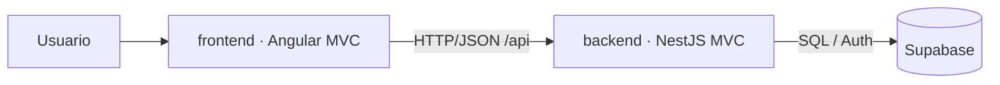

# Sistema de Registro — 44° Convención Ministerial

> **Estado actual:** Fase 0 — Arquitectura definida y esqueleto de carpetas creado. Aún no hay código de aplicación.

Sistema web para registrar la estructura organizacional (departamentos/regiones, distritos, iglesias y pastores) y la asistencia de pastores a la **44° Convención Ministerial de la Iglesia de Dios de la Profecía — Bolivia**, Cochabamba, 1 al 3 de diciembre de 2026.

## Arquitectura general



- **Patrón:** MVC en ambas capas, con proyectos separados `backend/` y `frontend/`.
- **Backend:** NestJS + TypeScript. Modelo = entidades/repositorios/servicios; Vista = DTOs y mappers JSON; Controlador = `@Controller()` con rutas HTTP.
- **Frontend:** Angular standalone + TypeScript. Modelo = servicios HTTP y estado con signals; Vista = componentes presentacionales; Controlador = componentes de página.
- **Datos y autenticación:** Supabase (PostgreSQL + Auth + RLS). El backend usa un cliente con contexto de usuario y un cliente administrativo solo para gestionar usuarios/roles.
- **Estándares:** Clean Code, SOLID, Conventional Commits, TypeScript estricto.

## Estructura del repositorio

```text
/
├── README.md
├── CONTRIBUTING.md
├── convenci_n_ministerial.md      # Guía visual (existente)
├── docs/                          # Documentación técnica
├── backend/                       # API REST MVC (NestJS + TS)
│   ├── src/{config,modules,models,views,controllers,guards,pipes,interceptors,filters}
│   ├── tests/{unit,integration}
│   └── .env.example
├── frontend/                      # App web MVC (Angular)
│   └── src/app/{core,shared,models,views,controllers,routes}
├── supabase/                      # Migraciones y seed (se crea en Fase 1)
```

## Documentación

| Documento | Contenido |
| --- | --- |
| [Índice de documentación](docs/00-indice.md) | Mapa de todos los documentos |
| [Contexto y alcance](docs/01-contexto-y-alcance.md) | Problema, objetivos, qué entra y qué no |
| [Requisitos](docs/02-requisitos.md) | Requisitos funcionales, no funcionales e historias |
| [Roles y permisos](docs/03-roles-y-permisos.md) | Matriz RBAC y su relación con RLS |
| [Modelo de datos](docs/04-modelo-de-datos.md) | Entidades, cardinalidades y DDL sugerido |
| [Arquitectura MVC](docs/05-arquitectura.md) | Backend, frontend, carpetas y flujos |
| [Supabase](docs/06-supabase.md) | Auth vía backend, RLS, migraciones, entorno |
| [Contratos y tipos](docs/07-contratos-y-tipos.md) | Modelos TS, DTOs y errores |
| [Estándares y Clean Code](docs/08-estandares-y-clean-code.md) | Convenciones, revisiones y pruebas |
| [Plan de trabajo](docs/09-plan-de-trabajo.md) | Fases, entregables y definición de terminado |
| [Glosario y supuestos](docs/10-glosario-y-supuestos.md) | Términos y preguntas pendientes |
| [Decisiones (ADR)](docs/11-registro-de-decisiones.md) | Decisiones técnicas y su justificación |
| [Pantallas y flujos](docs/12-pantallas-y-flujos.md) | Inventario de pantallas y recorridos |
| [API REST](docs/13-api-rest.md) | Endpoints, respuestas y códigos de error |
| [Guía UI/UX existente](convenci_n_ministerial.md) | Paleta, tipografía y componentes |

## Puntos abiertos

Confirmar antes de implementar (ver [glosario y supuestos](docs/10-glosario-y-supuestos.md)):

1. El significado exacto de «skills de REA».
2. Si «región» y «departamento» son el mismo nivel o dos niveles distintos.
3. La lista definitiva de roles (se propone administrador, operador, pastor y consultor).
4. NestJS como framework del backend (confirmado).
