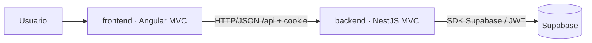

# Sistema de Registro — 44° Convención Ministerial

> **Estado actual:** aplicación implementada (backend NestJS + frontend Angular + migración de Supabase). Compilación y pruebas unitarias en verde. Pendiente: configurar las credenciales reales de Supabase.

Sistema web para registrar la estructura organizacional (departamentos/regiones, distritos, iglesias y pastores) y la asistencia de pastores a la **44° Convención Ministerial de la Iglesia de Dios de la Profecía — Bolivia**, Cochabamba, 1 al 3 de diciembre de 2026.

## Arquitectura general



- **Patrón:** MVC en ambos proyectos, separados en `backend/` y `frontend/`.
- **Backend:** NestJS + TypeScript. Modelo = entidades/repositorios/servicios; Vista = DTOs y mappers JSON; Controlador = `@Controller()`.
- **Frontend:** Angular standalone + TypeScript + signals. Modelo = servicios HTTP y stores; Vista = componentes presentacionales; Controlador = componentes de página.
- **Datos y autenticación:** Supabase (PostgreSQL + Auth + RLS). El frontend **nunca** habla con Supabase.
- **Estándares:** Clean Code, SOLID, TypeScript estricto, Conventional Commits.

## Reglas de negocio implementadas

- Solo el **administrador** crea departamentos/regiones, distritos, iglesias y usuarios de registro.
- El **operador** (usuario de registro) crea pastores y registra asistencia.
- Del pastor solo se guardan **nombre y apellido**.
- La **fecha/hora** (`created_at` / `checked_in_at`) y **quién registró** (`registered_by`) se generan automáticamente desde la sesión; RLS exige que `registered_by = auth.uid()`.
- Un pastor no puede registrarse dos veces en el mismo evento.
- Un pastor responsable dirige como máximo una iglesia activa.

## Estructura del repositorio

```text
/
├── README.md
├── CONTRIBUTING.md
├── convenci_n_ministerial.md      # Guía visual (existente, intacta)
├── docs/                          # Documentación técnica (01…14)
├── supabase/
│   ├── migrations/0001_init.sql   # Esquema, RLS, triggers y vista de reporte
│   └── seed.sql                   # Roles, Cochabamba, Distrito Central, evento
├── backend/                       # API REST MVC (NestJS + TS)
│   ├── src/{config,modules,models,views,controllers,guards,pipes,interceptors,filters,decorators,errors}
│   ├── tests/unit/attendance.service.spec.ts
│   └── .env.example
└── frontend/                      # App web MVC (Angular)
    ├── src/app/{core,models,views,controllers,routes}
    ├── src/environments/environment.ts
    └── .env.example
```

## Inicio rápido

1. Cree el proyecto en Supabase y ejecute la migración y el seed: **[docs/14-guia-supabase.md](docs/14-guia-supabase.md)**.
2. Copie `backend/.env.example` a `backend/.env` y complete las claves de Supabase.
3. En `frontend/src/environments/environment.ts`, confirme `apiBaseUrl` (Angular no lee `.env`).
4. Ejecute en dos terminales:

```bash
cd backend && npm install && npm run start:dev
cd frontend && npm install && npm start
```

5. Abra http://localhost:4200 e ingrese con el administrador.

## Comandos útiles

| Proyecto | Comando | Descripción |
| --- | --- | --- |
| `backend/` | `npm run start:dev` | API en http://localhost:3000/api |
| `backend/` | `npm run typecheck` | Verificación estricta de tipos |
| `backend/` | `npm test` | Pruebas unitarias (Jest) |
| `backend/` | `npm run build` | Compilación de producción |
| `frontend/` | `npm start` | App en http://localhost:4200 |
| `frontend/` | `npm run build` | Compilación de producción |

## Documentación

| Documento | Contenido |
| --- | --- |
| [Índice de documentación](docs/00-indice.md) | Mapa de todos los documentos |
| [Contexto y alcance](docs/01-contexto-y-alcance.md) | Problema, objetivos, qué entra y qué no |
| [Requisitos](docs/02-requisitos.md) | Requisitos funcionales, no funcionales e historias |
| [Roles y permisos](docs/03-roles-y-permisos.md) | Matriz RBAC y su relación con RLS |
| [Modelo de datos](docs/04-modelo-de-datos.md) | Entidades, cardinalidades y DDL sugerido |
| [Arquitectura MVC](docs/05-arquitectura.md) | Backend, frontend, carpetas y flujos |
| [Supabase](docs/06-supabase.md) | Auth vía backend, RLS, migraciones, entorno |
| [Contratos y tipos](docs/07-contratos-y-tipos.md) | Modelos TS, DTOs y errores |
| [Estándares y Clean Code](docs/08-estandares-y-clean-code.md) | Convenciones, revisiones y pruebas |
| [Plan de trabajo](docs/09-plan-de-trabajo.md) | Fases, entregables y definición de terminado |
| [Glosario y supuestos](docs/10-glosario-y-supuestos.md) | Términos y preguntas pendientes |
| [Decisiones (ADR)](docs/11-registro-de-decisiones.md) | Decisiones técnicas y su justificación |
| [Pantallas y flujos](docs/12-pantallas-y-flujos.md) | Inventario de pantallas y recorridos |
| [API REST](docs/13-api-rest.md) | Endpoints, respuestas y códigos de error |
| [Guía Supabase](docs/14-guia-supabase.md) | Paso a paso para crear la base de datos |
| [Guía UI/UX existente](convenci_n_ministerial.md) | Paleta, tipografía y componentes |

## Puntos abiertos

1. El significado exacto de «skills de REA».
2. Si «región» y «departamento» son el mismo nivel o dos niveles distintos (se implementó un campo `kind` que admite ambos).
3. La lista definitiva de roles (implementada: `admin`, `operator`, `pastor`, `viewer`).
