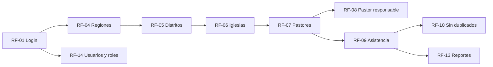

# 02 · Requisitos

Prioridad: **A** (imprescindible), **M** (importante), **C** (deseable). Convención MoSCoW: Must / Should / Could.

## 1. Requisitos funcionales

| ID | Requisito | Prioridad |
| --- | --- | --- |
| RF-01 | Iniciar sesión con correo y contraseña | A |
| RF-02 | Cerrar sesión e invalidar la sesión local | A |
| RF-03 | Redirigir al usuario según su rol después de iniciar sesión | A |
| RF-04 | Crear, editar, desactivar y listar departamentos/regiones | A |
| RF-05 | Crear, editar, desactivar y listar distritos, asociándolos a una región | A |
| RF-06 | Crear, editar, desactivar y listar iglesias, asociándolas a un distrito | A |
| RF-07 | Crear, editar, desactivar y listar pastores | A |
| RF-08 | Asignar un pastor responsable (`lead pastor`) a una iglesia | A |
| RF-09 | Registrar la asistencia de un pastor al evento con fecha y usuario que registra | A |
| RF-10 | Evitar asistencias duplicadas del mismo pastor en el mismo evento | A |
| RF-11 | Buscar y filtrar pastores por nombre, región, distrito e iglesia | M |
| RF-12 | Consultar el detalle de una iglesia con su distrito, región y pastor | M |
| RF-13 | Ver reportes de asistencia agrupados por región, distrito e iglesia | M |
| RF-14 | Gestionar usuarios y asignarles un rol (solo administrador) | M |
| RF-15 | Cambiar la propia contraseña | C |
| RF-16 | Recuperar contraseña por correo | C |
| RF-17 | Exportar reporte a CSV | C |

## 2. Requisitos no funcionales

| ID | Requisito | Criterio verificable |
| --- | --- | --- |
| RNF-01 | Seguridad | RLS activo en todas las tablas de dominio; `service_role` solo existe en `backend/`, nunca en el frontend |
| RNF-02 | Autorización | Cada acción sensible se valida en **frontend y backend** (RLS) |
| RNF-03 | Tipado | `strict: true`, cero `any` en código de aplicación |
| RNF-04 | Rendimiento | Listados paginados (20–50 filas) e índices en columnas de búsqueda |
| RNF-05 | Disponibilidad | Manejo explícito de estados: cargando, vacío, error, éxito |
| RNF-06 | Usabilidad | Interacción táctil mínima de 48 px; contraste AA; inputs de 16 px |
| RNF-07 | Responsive | Útil en 360 px, 768 px y 1440 px de ancho |
| RNF-08 | Accesibilidad | Navegación por teclado, etiquetas en formularios, `aria-live` en resultados |
| RNF-09 | Auditabilidad | Toda creación/edición guarda `created_at`, `updated_at` y `created_by` cuando aplica |
| RNF-10 | Mantenibilidad | MVC desacoplado; repositorios detrás de interfaces; cobertura ≥ 80 % en servicios del backend |
| RNF-11 | Privacidad | No exponer correos ni teléfonos de pastores a roles sin permiso |
| RNF-12 | Idioma | Interfaz 100 % en español; mensajes de error comprensibles |
| RNF-13 | Configuración | URLs y claves por variable de entorno en `backend/` y `frontend/`; sin secretos en el repo |
| RNF-14 | Arquitectura | MVC en `backend/` y `frontend/`; comunicación exclusiva por API REST `/api` |
| RNF-15 | Contrato | Todo endpoint documentado en [13-api-rest.md](13-api-rest.md) con códigos de estado y errores |

## 3. Historias de usuario

### US-01 — Inicio de sesión

**Como** usuario autorizado, **quiero** iniciar sesión con mi correo y contraseña **para** acceder a las funciones de mi rol.

**Criterios de aceptación**

```gherkin
Dado que estoy en la pantalla de login
Cuando ingreso credenciales válidas
Entonces soy redirigido a la pantalla inicial según mi rol
Y se guarda la sesión de Supabase de forma segura

Dado que ingreso credenciales inválidas
Cuando envío el formulario
Entonces veo un mensaje claro y no se crea ninguna sesión

Dado que mi cuenta está desactivada
Cuando intento iniciar sesión
Entonces el acceso es denegado
```

### US-02 — Alta de estructura geográfica

**Como** administrador, **quiero** registrar departamentos/regiones y distritos **para** organizar las iglesias.

```gherkin
Dado que soy administrador
Cuando creo un distrito indicando su región
Entonces el distrito queda asociado a esa región
Y no puedo crear otro distrito con el mismo nombre en la misma región

Dado que intento eliminar una región con distritos asociados
Entonces el sistema me ofrece desactivarla en vez de borrarla
```

### US-03 — Alta de iglesia con pastor responsable

**Como** administrador u operador, **quiero** registrar una iglesia en un distrito y asignarle un pastor **para** tener la jerarquía completa.

```gherkin
Dado que selecciono un distrito
Cuando guardo una iglesia con nombre y pastor responsable
Entonces la iglesia aparece listada con distrito, región y pastor
Y el pastor queda marcado como responsable de esa iglesia

Dado que el nombre de la iglesia ya existe en ese distrito
Cuando intento guardar
Entonces se muestra un error de duplicado
```

### US-04 — Registro de asistencia

**Como** operador, **quiero** registrar la asistencia de un pastor **para** contabilizar la participación en la convención.

```gherkin
Dado que busco un pastor por nombre
Cuando selecciono su nombre y confirmo asistencia
Entonces se crea un registro con fecha, evento y mi usuario
Y el pastor aparece como «Presente»

Dado que el pastor ya fue registrado en el mismo evento
Cuando intento registrarlo nuevamente
Entonces se muestra «Ya registrado» y no se crea un duplicado
```

### US-05 — Consulta de reportes

**Como** consultor, **quiero** ver la asistencia agrupada por distrito **para** informar a la organización.

```gherkin
Dado que tengo rol consultor
Cuando abro el reporte de asistencia
Entonces veo totales por región, distrito e iglesia
Y no veo opciones de edición
```

## 4. Reglas de negocio

| ID | Regla |
| --- | --- |
| RN-01 | Todo distrito pertenece exactamente a una región activa. |
| RN-02 | Toda iglesia pertenece exactamente a un distrito activo. |
| RN-03 | Una iglesia tiene como máximo un pastor responsable. |
| RN-04 | Un pastor responsable dirige como máximo una iglesia (confirmable). |
| RN-05 | Un pastor pertenece a una iglesia; puede no tener iglesia asignada temporalmente. |
| RN-06 | No se eliminan registros de la estructura; se desactivan (`is_active = false`). |
| RN-07 | Un pastor no puede ser registrado dos veces en el mismo evento. |
| RN-08 | Solo el administrador crea o cambia usuarios y roles. |
| RN-09 | Los nombres son únicos dentro de su padre (distrito por región, iglesia por distrito). |
| RN-10 | Toda asistencia conserva quién la registró y cuándo. |

## 5. Dependencias entre requisitos


