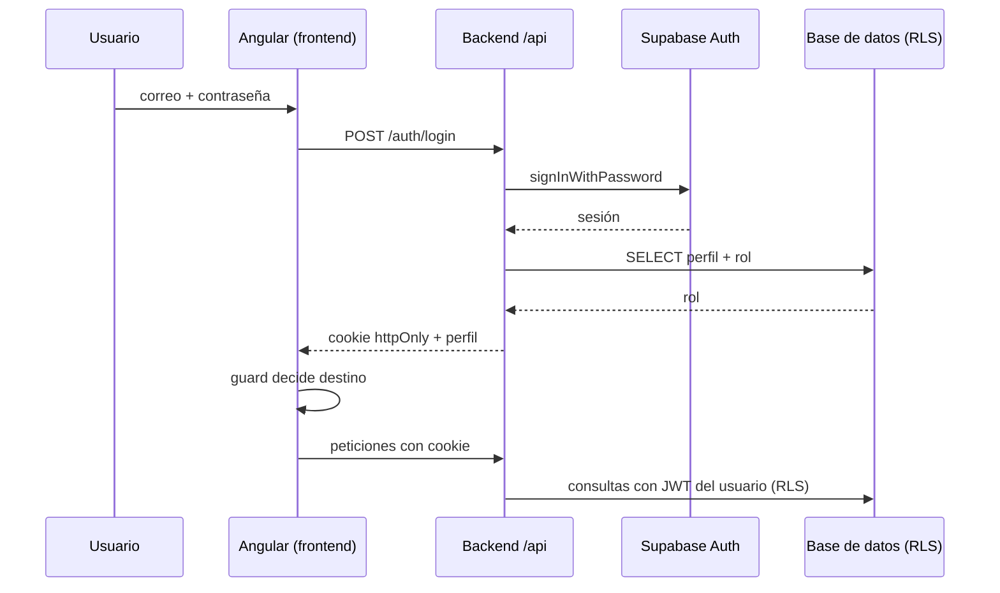

# 03 · Roles y permisos

> Estado: **propuesta**. El requerimiento menciona «estos roles» pero solo describe explícitamente al administrador. Confirmar la lista antes de implementar.

## 1. Catálogo propuesto

| Rol | Código | Descripción | Quién lo usa |
| --- | --- | --- | --- |
| Administrador | `admin` | Acceso total: estructura, pastores, usuarios, roles y reportes | Coordinación nacional |
| Operador | `operator` | Registro de asistencia y mantenimiento de iglesias/pastores | Secretaría de convención |
| Pastor | `pastor` | Consulta de sus datos y los de su iglesia; confirma su asistencia si se habilita | Pastores participantes |
| Consultor | `viewer` | Solo lectura de listados y reportes | Auditores / observadores |

Regla de oro: **un usuario tiene un solo rol activo**. Si se necesitan varios, se modela `user_roles` en el futuro (ADR pendiente).

## 2. Matriz de permisos

Leyenda: ✅ permitido · ⚠️ solo lectura · ❌ denegado · 🟡 según alcance (ver §3).

| Recurso / Acción | `admin` | `operator` | `pastor` | `viewer` |
| --- | --- | --- | --- | --- |
| Ver regiones/departamentos | ✅ | ✅ | ⚠️ | ⚠️ |
| Crear / editar / desactivar región | ✅ | ❌ | ❌ | ❌ |
| Ver distritos | ✅ | ✅ | ⚠️ | ⚠️ |
| Crear / editar / desactivar distrito | ✅ | ❌ | ❌ | ❌ |
| Ver iglesias | ✅ | ✅ | 🟡 | ⚠️ |
| Crear / editar iglesia | ✅ | ✅ | ❌ | ❌ |
| Ver pastores | ✅ | ✅ | 🟡 | ⚠️ |
| Crear / editar pastor | ✅ | ✅ | ❌ | ❌ |
| Asignar pastor responsable | ✅ | ✅ | ❌ | ❌ |
| Registrar asistencia | ✅ | ✅ | 🟡 | ❌ |
| Ver reportes globales | ✅ | ✅ | ❌ | ✅ |
| Ver reporte de su iglesia/distrito | ✅ | ✅ | 🟡 | ✅ |
| Gestionar usuarios y roles | ✅ | ❌ | ❌ | ❌ |
| Cambiar su propia contraseña | ✅ | ✅ | ✅ | ✅ |

## 3. Alcance de datos (row-level scope)

El rol determina **qué puede hacer**; el alcance determina **sobre qué filas**.

| Rol | Alcance |
| --- | --- |
| `admin` | Todas las filas |
| `operator` | Todas las filas de su evento vigente |
| `pastor` | Su propio perfil, su iglesia y su distrito; su propio registro de asistencia |
| `viewer` | Todas las filas en modo solo lectura |

> Si el pastor debe ver solo su iglesia, la política RLS compara `church_id` del perfil con la fila consultada.

## 4. Modelo de autorización

```text
auth.users (Supabase Auth)
        │ 1:1
        ▼
public.profiles ──N:1──► public.roles
        │
        ├── region_id?   (alcance opcional)
        ├── district_id? (alcance opcional)
        └── church_id?   (alcance opcional)
```

**Reglas de implementación**

1. El rol se guarda en `public.roles` y se referencia desde `profiles`; **no** se confía en un claim editable por el cliente.
2. Se expone una función `security definer` `public.current_role()` para que RLS consulte el rol sin recursively triggers.
3. El frontend usa el rol solo para **mostrar u ocultar** controles; la autoridad real está en RLS.
4. Ninguna petición desde Angular habla con Supabase ni utiliza la clave `service_role`; todo pasa por `/api`.
5. Las operaciones de administración de usuarios se hacen en `backend/` con el cliente admin de Supabase y el endpoint `/api/users`, protegido por `authorize('admin')`.

## 5. Mapa rol → pantalla inicial

| Rol | Destino tras login |
| --- | --- |
| `admin` | Panel de control (`/dashboard`) |
| `operator` | Registro rápido de asistencia (`/asistencia/nuevo`) |
| `pastor` | Mi participación (`/mi-participacion`) |
| `viewer` | Reportes (`/reportes`) |

## 6. Flujo de acceso



## 7. Casos especiales

- **Usuario desactivado** (`is_active = false`): se le niega el ingreso y se cierra cualquier sesión activa.
- **Perfil sin rol**: se muestra pantalla de acceso pendiente; no se otorga ningún permiso por defecto (fail-closed).
- **Cambio de rol**: surte efecto en la siguiente petición, porque RLS consulta la tabla en cada llamada.
- **Multi-evento**: el alcance se complementa con `event_id` activo; ver [04-modelo-de-datos.md](04-modelo-de-datos.md).

## 8. Pendiente de confirmación

- ¿El pastor podrá registrarse a sí mismo o solo lo registra el operador?
- ¿Existirá un rol «coordinador de distrito» con alcance limitado a su distrito?
- ¿Se permite más de un rol por usuario?
