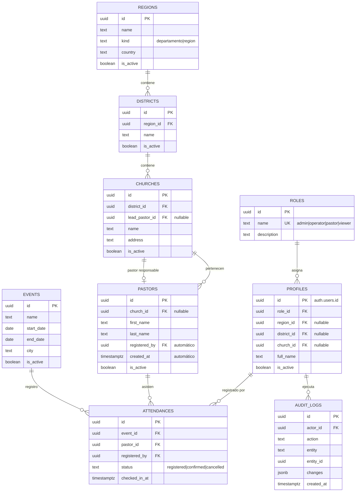

# 04 · Modelo de datos

> Estado: **implementado**. PostgreSQL en Supabase. Convención: tablas en `snake_case` y plural; claves primarias `uuid`; fechas `timestamptz`.
>
> La fuente autoritativa es [`../supabase/migrations/0001_init.sql`](../supabase/migrations/0001_init.sql); el DDL de este documento es una referencia didáctica. Pasos para ejecutarlo: [14-guia-supabase.md](14-guia-supabase.md).

## 1. Diagrama entidad-relación



## 2. Decisiones de modelado

| Decisión | Justificación |
| --- | --- |
| `regions.kind` con `departamento` o `region` | Evita dos tablas casi idénticas; si se confirma que son niveles distintos, se separa con un ADR |
| `districts.region_id` obligatorio | RN-01: todo distrito pertenece a una región |
| `churches.district_id` obligatorio | RN-02: toda iglesia pertenece a un distrito |
| `churches.lead_pastor_id` nullable | Una iglesia puede no tener responsable asignado al momento del alta |
| `pastors.church_id` nullable | Un pastor puede estar temporalmente sin iglesia (RN-05) |
| `pastors.registered_by` NOT NULL | Auditoría: siempre se sabe quién registró al pastor |
| `attendances` con `UNIQUE(event_id, pastor_id)` | RN-07: evita duplicados a nivel de base de datos |
| Borrado lógico (`is_active`) | RN-06: conserva historial y evita huérfanos |
| `events` separado | Permite reutilizar el sistema en futuras convenciones sin migrar datos |

### Jerarquía resumida

```text
Región / Departamento (regions)
└── Distrito (districts)
    └── Iglesia (churches)
        ├── Pastor responsable (churches.lead_pastor_id → pastors)
        └── Pastores (pastors.church_id)
```

## 3. Especificación de tablas

### `roles`

| Columna | Tipo | Restricción | Descripción |
| --- | --- | --- | --- |
| `id` | `uuid` | PK, default `gen_random_uuid()` | Identificador |
| `name` | `text` | UNIQUE, NOT NULL | `admin`, `operator`, `pastor`, `viewer` |
| `description` | `text` | — | Descripción legible |

### `regions`

| Columna | Tipo | Restricción | Descripción |
| --- | --- | --- | --- |
| `id` | `uuid` | PK | Identificador |
| `name` | `text` | NOT NULL | Ej. «Cochabamba» |
| `kind` | `text` | CHECK IN ('departamento','region') | Tipo de unidad |
| `country` | `text` | DEFAULT 'Bolivia' | País |
| `is_active` | `boolean` | DEFAULT true | Borrado lógico |
| `created_at` / `updated_at` | `timestamptz` | DEFAULT `now()` | Auditoría |

**Única:** `(lower(name), kind, country)` donde `is_active = true`.

### `districts`

| Columna | Tipo | Restricción | Descripción |
| --- | --- | --- | --- |
| `id` | `uuid` | PK | Identificador |
| `region_id` | `uuid` | FK → `regions.id`, NOT NULL | Región superior |
| `name` | `text` | NOT NULL | Ej. «Distrito Norte» |
| `is_active` | `boolean` | DEFAULT true | Borrado lógico |
| `created_at` / `updated_at` | `timestamptz` | — | Auditoría |

**Única:** `(region_id, lower(name))`.

### `churches`

| Columna | Tipo | Restricción | Descripción |
| --- | --- | --- | --- |
| `id` | `uuid` | PK | Identificador |
| `district_id` | `uuid` | FK → `districts.id`, NOT NULL | Distrito superior |
| `lead_pastor_id` | `uuid` | FK → `pastors.id`, NULL | Pastor responsable |
| `name` | `text` | NOT NULL | Nombre de la iglesia |
| `address` | `text` | NULL | Dirección opcional |
| `is_active` | `boolean` | DEFAULT true | Borrado lógico |
| `created_at` / `updated_at` | `timestamptz` | — | Auditoría |

**Única:** `(district_id, lower(name))`.

> Circularidad `churches ↔ pastors`: se resuelve insertando la iglesia sin `lead_pastor_id` y luego actualizando. Alternativa: tabla puente `church_lead_pastors` si se quiere histórico de responsables.

### `pastors`

| Columna | Tipo | Restricción | Descripción |
| --- | --- | --- | --- |
| `id` | `uuid` | PK | Identificador |
| `church_id` | `uuid` | FK → `churches.id`, NULL | Iglesia de pertenencia |
| `first_name` / `last_name` | `text` | NOT NULL | **Únicos datos personales guardados** |
| `registered_by` | `uuid` | FK → `profiles.id`, NOT NULL | Usuario que registró (automático) |
| `is_active` | `boolean` | DEFAULT true | Borrado lógico |
| `created_at` / `updated_at` | `timestamptz` | DEFAULT `now()` | Fecha y hora de registro (automáticas) |

> Según el requerimiento final, del pastor solo se guardan nombre y apellido. No se almacenan teléfono ni correo. RLS exige `registered_by = auth.uid()` en el alta.

### `events`

| Columna | Tipo | Restricción | Descripción |
| --- | --- | --- | --- |
| `id` | `uuid` | PK | Identificador |
| `name` | `text` | NOT NULL | «44° Convención Ministerial» |
| `motto` | `text` | NULL | «Testifiquemos» |
| `start_date` / `end_date` | `date` | NOT NULL | 2026-12-01 / 2026-12-03 |
| `city` | `text` | NULL | Cochabamba |
| `is_active` | `boolean` | DEFAULT true | Evento vigente |

### `attendances`

| Columna | Tipo | Restricción | Descripción |
| --- | --- | --- | --- |
| `id` | `uuid` | PK | Identificador |
| `event_id` | `uuid` | FK → `events.id`, NOT NULL | Evento |
| `pastor_id` | `uuid` | FK → `pastors.id`, NOT NULL | Pastor asistente |
| `registered_by` | `uuid` | FK → `profiles.id`, NOT NULL | Usuario que registró |
| `status` | `text` | CHECK IN ('registered','confirmed','cancelled'), DEFAULT 'registered' | Estado |
| `checked_in_at` | `timestamptz` | DEFAULT `now()` | Momento del registro |
| `notes` | `text` | NULL | Observación opcional |

**Única:** `(event_id, pastor_id)`.

### `profiles` y `audit_logs`

Ver [06-supabase.md](06-supabase.md) para el detalle de `profiles` ligado a `auth.users` y el trigger de creación automática. `audit_logs` guarda `actor_id`, `action`, `entity`, `entity_id`, `changes jsonb` y `created_at`.

## 4. Índices sugeridos

```sql
create index districts_region_id_idx on public.districts (region_id);
create index churches_district_id_idx on public.churches (district_id);
create index churches_lead_pastor_id_idx on public.churches (lead_pastor_id);
create index pastors_church_id_idx on public.pastors (church_id);
create index pastors_name_idx on public.pastors (lower(last_name), lower(first_name));
create index attendances_event_pastor_idx on public.attendances (event_id, pastor_id);
create index attendances_event_date_idx on public.attendances (event_id, checked_in_at desc);
create index audit_logs_entity_idx on public.audit_logs (entity, entity_id);
```

## 5. Borrador de DDL

```sql
create extension if not exists pgcrypto;

create type region_kind as enum ('departamento', 'region');
create type attendance_status as enum ('registered', 'confirmed', 'cancelled');

create table public.roles (
  id uuid primary key default gen_random_uuid(),
  name text not null unique check (name in ('admin','operator','pastor','viewer')),
  description text
);

create table public.profiles (
  id uuid primary key references auth.users (id) on delete cascade,
  role_id uuid references public.roles (id),
  full_name text not null,
  region_id uuid,
  district_id uuid,
  church_id uuid,
  is_active boolean not null default true,
  created_at timestamptz not null default now(),
  updated_at timestamptz not null default now()
);

create table public.regions (
  id uuid primary key default gen_random_uuid(),
  name text not null,
  kind region_kind not null,
  country text not null default 'Bolivia',
  is_active boolean not null default true,
  created_at timestamptz not null default now(),
  updated_at timestamptz not null default now()
);
create unique index regions_unique_active_name
  on public.regions (lower(name), kind, country) where is_active;

create table public.districts (
  id uuid primary key default gen_random_uuid(),
  region_id uuid not null references public.regions (id),
  name text not null,
  is_active boolean not null default true,
  created_at timestamptz not null default now(),
  updated_at timestamptz not null default now()
);
create unique index districts_unique_active_name
  on public.districts (region_id, lower(name)) where is_active;

create table public.churches (
  id uuid primary key default gen_random_uuid(),
  district_id uuid not null references public.districts (id),
  lead_pastor_id uuid,
  name text not null,
  address text,
  is_active boolean not null default true,
  created_at timestamptz not null default now(),
  updated_at timestamptz not null default now()
);
create unique index churches_unique_active_name
  on public.churches (district_id, lower(name)) where is_active;

create table public.pastors (
  id uuid primary key default gen_random_uuid(),
  church_id uuid references public.churches (id),
  first_name text not null,
  last_name text not null,
  registered_by uuid not null references public.profiles (id),
  is_active boolean not null default true,
  created_at timestamptz not null default now(),
  updated_at timestamptz not null default now()
);

-- La FK se agrega después para resolver la circularidad churches <-> pastors.
alter table public.churches
  add constraint churches_lead_pastor_fkey
  foreign key (lead_pastor_id) references public.pastors (id);

-- Alcance opcional de los perfiles.
alter table public.profiles
  add constraint profiles_region_fkey foreign key (region_id) references public.regions (id),
  add constraint profiles_district_fkey foreign key (district_id) references public.districts (id),
  add constraint profiles_church_fkey foreign key (church_id) references public.churches (id);

-- Un pastor responsable dirige como máximo una iglesia (RN-04, confirmable).
create unique index churches_one_lead_pastor
  on public.churches (lead_pastor_id) where lead_pastor_id is not null and is_active;

create table public.events (
  id uuid primary key default gen_random_uuid(),
  name text not null,
  motto text,
  start_date date not null,
  end_date date not null,
  city text,
  is_active boolean not null default true,
  created_at timestamptz not null default now(),
  check (end_date >= start_date)
);

create table public.attendances (
  id uuid primary key default gen_random_uuid(),
  event_id uuid not null references public.events (id),
  pastor_id uuid not null references public.pastors (id),
  registered_by uuid not null references public.profiles (id),
  status attendance_status not null default 'registered',
  notes text,
  checked_in_at timestamptz not null default now(),
  unique (event_id, pastor_id)
);

create table public.audit_logs (
  id uuid primary key default gen_random_uuid(),
  actor_id uuid references public.profiles (id),
  action text not null,
  entity text not null,
  entity_id uuid,
  changes jsonb not null default '{}'::jsonb,
  created_at timestamptz not null default now()
);
```

> Nota: el bloque ya está ordenado para poder ejecutarse: `profiles` se crea antes que `pastors`, la FK `churches.lead_pastor_id` se agrega al final con `alter table`, y los índices de esta sección se ejecutan después del DDL. En la práctica se fragmenta en varias migraciones (ver [06-supabase.md](06-supabase.md) §7).

## 6. Vistas de reporte sugeridas

```sql
create view public.v_attendance_summary as
select
  r.id as region_id, r.name as region_name,
  d.id as district_id, d.name as district_name,
  c.id as church_id, c.name as church_name,
  count(a.id) as total_registered,
  count(a.id) filter (where a.status = 'confirmed') as total_confirmed,
  max(a.checked_in_at) as last_check_in
from public.regions r
join public.districts d on d.region_id = r.id and d.is_active
left join public.churches c on c.district_id = d.id and c.is_active
left join public.pastors p on p.church_id = c.id and p.is_active
left join public.attendances a on a.pastor_id = p.id
group by r.id, r.name, d.id, d.name, c.id, c.name;
```

## 7. Datos semilla mínimos

- Roles: `admin`, `operator`, `pastor`, `viewer`.
- Región: `Cochabamba` (`departamento`, Bolivia).
- Distrito: `Distrito Central` → Cochabamba.
- Evento: `44° Convención Ministerial`, `Testifiquemos`, 2026-12-01 a 2026-12-03, Cochabamba.

> Los datos reales de iglesias y pastores **no** se versionan en el repositorio; se cargan por migración controlada o desde la app por el administrador.
