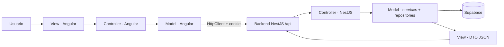
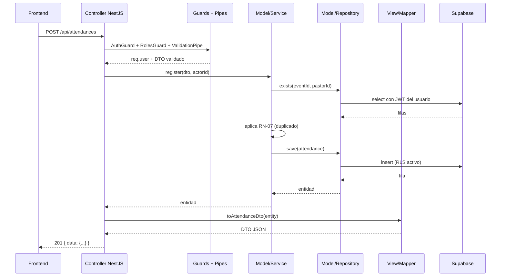
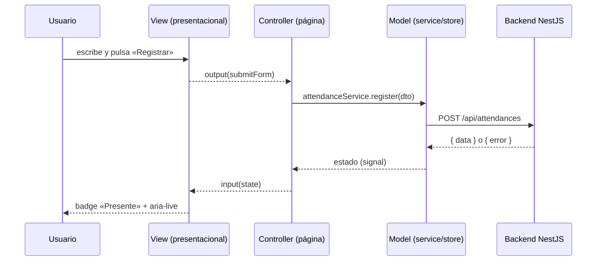
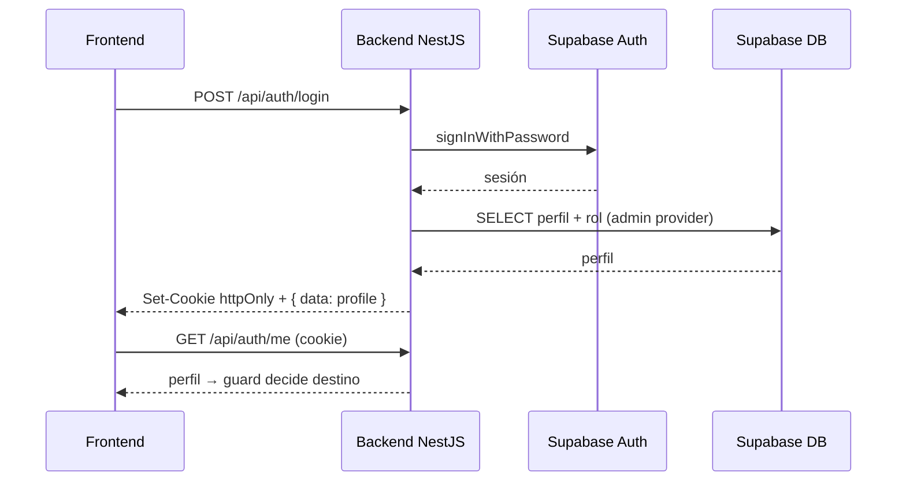

# 05 · Arquitectura MVC (backend NestJS + frontend Angular)

> Estado: **acordada en estructura**. Reemplaza la propuesta anterior de Clean Architecture (ADR-010) y el backend Express (ADR-013).

## 1. Visión general

El repositorio se divide en dos proyectos independientes que se comunican por HTTP/JSON:



| Proyecto | Tecnología | Patrón | Responsabilidad |
| --- | --- | --- | --- |
| `backend/` | **NestJS + TypeScript** | MVC | API REST, reglas de negocio, seguridad y acceso a Supabase |
| `frontend/` | Angular standalone + TypeScript | MVC | Interfaz, estado de la sesión y consumo de la API |
| Supabase | PostgreSQL + Auth + RLS | Servicio externo | Persistencia y autenticación |

**Regla de oro:** el frontend nunca habla con Supabase. Toda operación pasa por `/api`.

## 2. Estructura raíz

```text
/
├── README.md
├── CONTRIBUTING.md
├── convenci_n_ministerial.md
├── docs/
├── supabase/                       # migraciones y seed (Fase 1)
├── backend/                        # NestJS MVC
│   └── src/
│       ├── main.ts
│       ├── app.module.ts
│       ├── config/
│       ├── modules/
│       ├── models/{entities,repositories,services}
│       ├── views/{dtos,mappers}
│       ├── controllers/
│       ├── guards/
│       ├── pipes/
│       ├── interceptors/
│       ├── filters/
│       ├── middlewares/
│       ├── decorators/
│       ├── errors/
│       └── types/
└── frontend/                       # Angular MVC
    └── src/app/{core,shared,models,views,controllers,routes}
```

## 3. Backend MVC con NestJS

### 3.1 Roles del patrón

| Letra | Carpeta | Contiene | No debe contener |
| --- | --- | --- | --- |
| **Model** | `src/models/` | Entidades, repositorios Supabase y `@Injectable()` services con reglas de negocio | `@Req`/`@Res`, HTML, formato de respuesta HTTP |
| **View** | `src/views/` | DTOs de salida, mappers `snake_case → camelCase`, serialización de errores | Consultas a base de datos, reglas de negocio |
| **Controller** | `src/controllers/` | Clases `@Controller()` que reciben datos, delegan en services y devuelven DTO | SQL, cálculos de negocio, lógica de presentación compleja |

> En NestJS la «Vista» es la representación JSON documentada en [13-api-rest.md](13-api-rest.md): no hay plantillas HTML en el backend.

### 3.2 Estructura detallada

```text
backend/src/
├── main.ts                         # bootstrap, CORS, cookie-parser, prefijo /api
├── app.module.ts                   # módulo raíz
├── config/
│   ├── env.ts                      # validación de variables de entorno
│   ├── supabase-user.provider.ts   # cliente con JWT del usuario (RLS activo)
│   └── supabase-admin.provider.ts  # service_role (solo usuarios/roles)
├── modules/
│   ├── auth.module.ts
│   ├── users.module.ts
│   ├── structure.module.ts         # regiones y distritos
│   ├── churches.module.ts
│   ├── pastors.module.ts
│   ├── attendance.module.ts
│   └── reports.module.ts
├── models/
│   ├── entities/                   # region, district, church, pastor, attendance, profile
│   ├── repositories/               # supabase-*.repository.ts (@Injectable)
│   └── services/                   # auth, church, pastor, attendance, report (@Injectable)
├── views/
│   ├── dtos/                       # ChurchDto, AttendanceDto, UserDto (class-validator)
│   └── mappers/                    # toChurch(), toAttendanceDto()...
├── controllers/
│   ├── auth.controller.ts
│   ├── user.controller.ts
│   ├── region.controller.ts
│   ├── district.controller.ts
│   ├── church.controller.ts
│   ├── pastor.controller.ts
│   ├── attendance.controller.ts
│   └── report.controller.ts
├── guards/
│   ├── auth.guard.ts               # lee cookie → valida JWT → req.user
│   └── roles.guard.ts              # lee metadata de @Roles()
├── decorators/
│   ├── current-user.decorator.ts
│   └── roles.decorator.ts
├── pipes/
│   └── uuid.pipe.ts                # validación adicional de ids
├── interceptors/
│   ├── response.interceptor.ts     # envuelve respuestas en { data }
│   └── logging.interceptor.ts
├── filters/
│   └── all-exceptions.filter.ts    # AppError / HttpException → ApiError
├── middlewares/
│   └── cookie.middleware.ts
├── errors/
│   └── app-error.ts
└── types/
    └── database.types.ts           # generado por Supabase
```

### 3.3 Bootstrap (`main.ts`)

```ts
// concepto
app.setGlobalPrefix('api');
app.enableCors({ origin: env.frontendUrl, credentials: true });
app.use(cookieParser());                                  // o CookieMiddleware
app.useGlobalPipes(new ValidationPipe({ whitelist: true, transform: true }));
app.useGlobalInterceptors(new ResponseInterceptor());
app.useGlobalFilters(new AllExceptionsFilter());
await app.listen(env.port);
```

### 3.4 Flujo de una petición



### 3.5 Reglas del backend

1. **Controladores delgados:** usan `@CurrentUser()` y DTOs, llaman a un service y devuelven el DTO. Ideal ≤ 25 líneas.
2. **Services dueños de la lógica:** duplicados, jerarquía activa y reglas RN-01…RN-10 se validan en `models/services`.
3. **Repositorios son la única puerta a Supabase:** ningún service ni controller importa el SDK directamente.
4. **Views no consultan:** solo mapean entidades a la forma JSON acordada.
5. **Dos proveedores de Supabase:**
   - `supabase-user.provider.ts`: inyecta un cliente con el JWT del usuario → **RLS aplica**. Uso general.
   - `supabase-admin.provider.ts`: `service_role`, únicamente para crear usuarios y asignar roles. Nunca se expone al frontend.
6. **Validación en el límite:** DTO con `class-validator` + `ValidationPipe` global antes del controlador.
7. **Errores uniformes:** `AppError` se transforma en `filters/all-exceptions.filter.ts` al formato de error documentado.
8. **Módulos por feature:** cada módulo registra sus controladores y providers; las rutas se declaran con decoradores en los controladores.

## 4. Frontend MVC

### 4.1 Roles del patrón

| Letra | Carpeta | Contiene | Regla |
| --- | --- | --- | --- |
| **Model** | `src/app/models/` | Interfaces, servicios `HttpClient`, stores con `signal` | Único lugar que llama al backend |
| **View** | `src/app/views/` | Componentes presentacionales con template y estilos | Sin `HttpClient`; recibe `input()` y emite `output()` |
| **Controller** | `src/app/controllers/` | Componentes de página que coordinan eventos y estado | Sin SQL ni llamadas directas a Supabase; delega en el Model |

### 4.2 Estructura detallada

```text
frontend/src/app/
├── core/
│   ├── interceptors/               # withCredentials + errores 401
│   ├── guards/                     # auth.guard.ts, role.guard.ts
│   ├── tokens/
│   └── app.config.ts
├── shared/ui/                      # botones, tablas, badges, estados
├── models/
│   ├── auth/                       # auth.model.ts, auth.service.ts, auth.store.ts
│   ├── churches/
│   ├── pastors/
│   ├── attendance/
│   ├── reports/
│   └── api.types.ts                # ApiResponse<T>, ApiError
├── views/
│   ├── login/
│   ├── dashboard/
│   ├── structure/
│   ├── churches/
│   ├── pastors/
│   ├── attendance/
│   ├── reports/
│   └── profile/
├── controllers/
│   ├── login.controller.ts
│   ├── dashboard.controller.ts
│   ├── churches.controller.ts
│   ├── attendance.controller.ts
│   └── reports.controller.ts
└── routes/app.routes.ts
```

> Convención: `login.view.ts` + `.html` + `.scss` para la vista; `login.controller.ts` para el contenedor.

### 4.3 Flujo de una interacción



### 4.4 Reglas del frontend

1. Las vistas son **tontas**: no saben de HTTP, roles ni Supabase.
2. Los controladores son **delgados**: traducen eventos en llamadas al Model.
3. Los modelos son **dueños del estado** y de la comunicación con la API.
4. Un store por feature con `signal`/`computed`.
5. Cuatro estados obligatorios: `loading`, `empty`, `error`, `success`.
6. Reactive Forms; validación de formato en cliente y de negocio en el backend.
7. Guards basados en `GET /api/auth/me`.
8. Ningún componente importa `@supabase/supabase-js`.

## 5. Autenticación y sesión



- `AuthGuard` lee la cookie, valida el JWT con `supabase.auth.getUser(token)` y adjunta `req.user`.
- `RolesGuard` + `@Roles('admin', 'operator')` comprueban el rol desde `profiles`/`roles`.
- `@CurrentUser()` evita que el controlador lea `req` manualmente.
- Cookie **httpOnly, Secure, SameSite=Lax** gestionada por el backend; el frontend usa `withCredentials: true`.
- `AllExceptionsFilter` responde `401 UNAUTHORIZED` / `403 FORBIDDEN` según corresponda.

## 6. Seguridad por capas

| Capa | Responsabilidad |
| --- | --- |
| Frontend | Ocultar controles por rol y redirigir con guards |
| API NestJS | `AuthGuard`, `RolesGuard`, `ValidationPipe`, CORS restringido |
| Model/Service | Reglas de negocio (RN-01…RN-10) |
| Supabase | RLS como última barrera; constraints de base de datos |

**Prohibido:** `service_role` en `frontend/`, confiar en el rol enviado por el cliente, SQL concatenado, exponer correos/teléfonos sin permiso.

## 7. Pruebas por proyecto

| Proyecto | Nivel | Herramienta |
| --- | --- | --- |
| `backend/` | Unitarias de services con repositorios falsos | Jest |
| `backend/` | Integración de repositorios contra Supabase local | Jest + Supabase local |
| `backend/` | E2E de endpoints (cookie + DTOs) | Jest + Supertest |
| `frontend/` | Unitarias de modelos y stores | Vitest |
| `frontend/` | Componentes de vista | Angular Testing Library |
| `frontend/` | E2E login → iglesia → asistencia | Playwright |

## 8. Decisiones y consecuencias

| Decisión | Consecuencia |
| --- | --- |
| NestJS en el backend | Estructura modular y DI nativa; se mantiene MVC con `models/views/controllers` |
| Rutas en controladores | No se requiere carpeta `routes/` separada |
| class-validator + ValidationPipe | Validación idiomática en NestJS; DTOs con decoradores |
| Cookie httpOnly | Mejor contra XSS; el backend gestiona refresh |
| Supabase detrás del backend | El frontend no conoce la BD; RLS se conserva con el cliente por usuario |

## 9. Historial de arquitectura

| Versión anterior | Estado actual |
| --- | --- |
| Clean Architecture sin servidor | Reemplazada por MVC con backend y frontend (ADR-010) |
| Backend Express + Zod | Reemplazado por NestJS + class-validator (ADR-013) |
| Capas `domain/application/infrastructure` | Capas `models/views/controllers` en cada proyecto |
| Cliente Supabase en el frontend | Proveedores en `backend/src/config/` |
| Guard basado en perfil Supabase directo | `AuthGuard`/`RolesGuard` basados en `/api/auth/me` |

> Clean Code y SOLID se mantienen; solo cambia el framework y la organización física.
