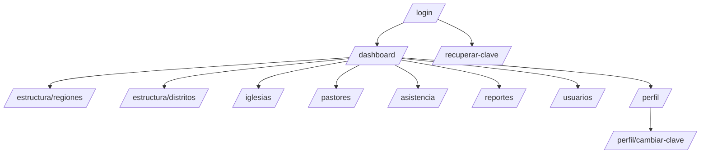
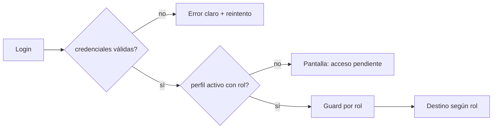
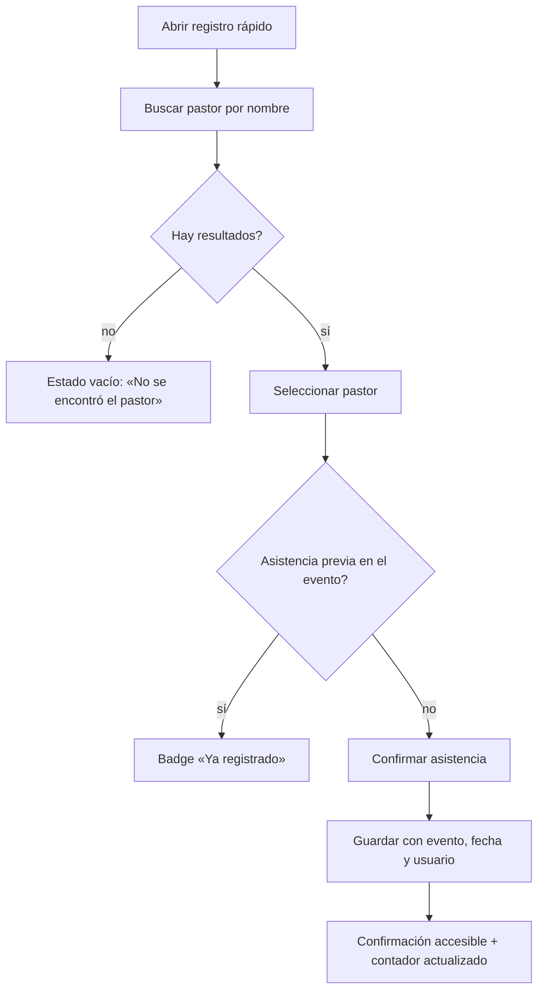
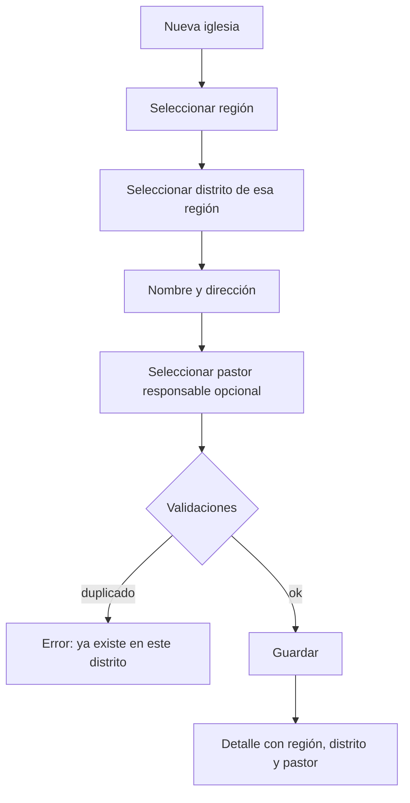

# 12 · Pantallas y flujos

> Estado: **borrador**. La identidad visual se toma de [convenci_n_ministerial.md](../convenci_n_ministerial.md). Las pantallas viven en `frontend/src/app/views/`, los componentes que las coordinan en `frontend/src/app/controllers/` y los datos en `frontend/src/app/models/`.

## 1. Mapa de navegación

## 2. Inventario de pantallas

| Ruta | Pantalla | Roles | Descripción |
| --- | --- | --- | --- |
| `/login` | Inicio de sesión | Público | Correo, contraseña, recordarme (C) |
| `/recuperar-clave` | Recuperar contraseña | Público | Envío de enlace (C) |
| `/dashboard` | Panel de control | Todos | Contadores y accesos rápidos según rol |
| `/estructura/regiones` | Regiones/departamentos | Admin, Operador, Consultor | Listado, alta, edición, desactivación |
| `/estructura/distritos` | Distritos | Admin, Operador, Consultor | Listado filtrable por región |
| `/iglesias` | Iglesias | Admin, Operador, Consultor | Listado con distrito, región y pastor |
| `/iglesias/:id` | Detalle de iglesia | Admin, Operador, Pastor, Consultor | Jerarquía, pastor responsable y asistentes |
| `/pastores` | Pastores | Admin, Operador, Consultor | Búsqueda, alta y edición |
| `/asistencia/nuevo` | Registro rápido | Admin, Operador | Buscar pastor y confirmar asistencia |
| `/asistencia` | Listado de asistencia | Admin, Operador, Consultor | Filtros por evento, ubicación y estado |
| `/reportes` | Reportes | Admin, Operador, Consultor | Totales por región/distrito/iglesia |
| `/mi-participacion` | Mi participación | Pastor | Su iglesia y su estado de asistencia |
| `/usuarios` | Usuarios y roles | Admin | Asignación de rol y activación |
| `/perfil` | Mi perfil | Todos | Datos propios y cambio de contraseña |

## 3. Flujo: inicio de sesión

**Estados obligatorios**

- Cargando: botón deshabilitado y spinner.
- Error: mensaje cerca del campo con `role="alert"`.
- Éxito: redirección sin flash de pantalla protegida.

## 4. Flujo: registro de asistencia

## 5. Flujo: alta de iglesia con jerarquía

## 6. Componentes visuales reutilizables

| Componente | Origen en la guía | Uso |
| --- | --- | --- |
| `AppShellComponent` | Fondo degradado y navbar | Layout autenticado |
| `BrandButtonComponent` | Botón dorado con degradado | Acciones primarias |
| `GlassCardComponent` | Glassmorphism sutil | Formularios y tarjetas |
| `StatusBadgeComponent` | Verde / dorado / rojo | Estados de asistencia |
| `TricolorBarComponent` | Barras rojo-amarillo-verde | Encabezados |
| `DataTableComponent` | Gris hielo en modo claro | Listados y reportes |
| `EmptyStateComponent` | Texto secundario | Sin resultados |
| `LoadingStateComponent` | Azul destello | Carga |

## 7. Lineamientos de diseño por pantalla

### Login

- Fondo `radial-gradient` de la guía, emblema circular arriba y banda tricolor sobre el título.
- Tarjeta con `rgba(30, 42, 120, 0.75)` y `backdrop-filter: blur(10px)`.
- Inputs blancos de 48 px con foco dorado.
- Texto de ayuda: «Use el correo y la contraseña asignados por la coordinación».

### Listados

- Buscador siempre visible; filtros de región/distrito en la misma fila en escritorio.
- Tabla en escritorio, tarjetas en móvil (≤ 768 px).
- Columnas de acción: Ver / Editar / Desactivar según permisos del rol.
- Paginación de 20 filas por defecto.

### Registro rápido

- Un solo campo principal de búsqueda y resultado seleccionable.
- Confirmación en dos pasos para evitar registros accidentales.
- Contador de asistentes actualizado vía señal al guardar.

### Reportes

- Tarjetas de totales: registrados, confirmados, por región.
- Tabla agrupada con jerarquía indentada.
- Exportación CSV deshabilitada visualmente para roles sin permiso (C).

## 8. Responsive

| Breakpoint | Comportamiento |
| --- | --- |
| < 480 px | Una columna; formularios apilados; tabla → tarjetas |
| 480–768 px | Una columna con filtros colapsables |
| 768–1200 px | Dos columnas; tabla con scroll horizontal |
| > 1200 px | Sidebar + contenido; tabla completa |

## 9. Criterios de aceptación visual

- Paleta y tipografías coinciden con la guía existente (Montserrat para títulos, Inter/Poppins para cuerpo).
- Ningún botón principal queda por debajo de 44 px de alto.
- Los estados de error usan `#D52B1E` sobre fondo claro con contraste suficiente.
- La pantalla funciona con teclado y lector de pantalla en los recorridos críticos.
